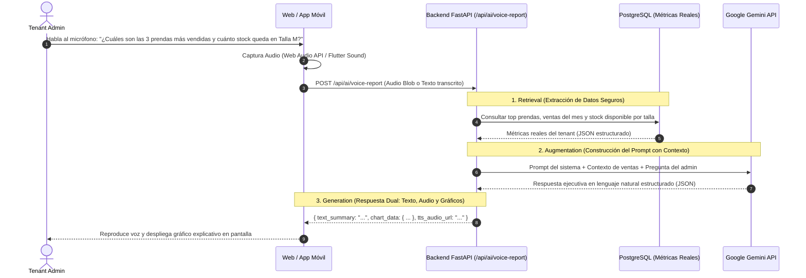

# MÓDULO DE INTELIGENCIA ARTIFICIAL Y MACHINE LEARNING
### FashionStore — Plataforma SaaS Multitenant E-Commerce
**Paquete de Dominio:** `p6_inteligencia_analitica`  
**Tecnologías:** Google Gemini API (RAG Asistido por Voz), Scikit-Learn, NumPy, Pandas, FastAPI

---

## 1. Visión y Capacidades del Módulo

El subsistema de Inteligencia Analítica proporciona a los administradores de cada tienda de moda herramientas avanzadas para la toma de decisiones basada en datos, estructurado en tres componentes:
1. **IA Generativa Asistida por Voz (Google Gemini API):** Consultas en lenguaje natural mediante audio o texto para obtener resúmenes de rendimiento comercial y auditoría de inventario.
2. **Machine Learning Supervisado (Predicción de Demanda):** Proyección cuantitativa de unidades requeridas por talla y categoría de prenda con base en estacionalidad textil.
3. **Machine Learning No Supervisado (Segmentación K-Means):** Agrupamiento de clientes según su comportamiento de compra y propensión a cambios o devoluciones.

---

## 2. IA Generativa Asistida por Voz (CU23)

### 2.1. Arquitectura RAG (Retrieval-Augmented Generation)



### 2.2. Prompt de Contexto Seguro (System Prompt RAG)
Para evitar alucinaciones, Gemini recibe únicamente agregaciones consolidadas del tenant autenticado:
```text
Eres el Asistente Ejecutivo de Inteligencia de Negocios de FashionStore para la empresa "{company_name}".
Responde con un tono profesional, claro, conciso y directo, orientado a la dirección de tiendas de ropa.

DATOS REALES DEL NEGOCIO (Contexto Seguro):
- Ventas totales del período: Bs {total_sales}
- Prenda más vendida: {top_product_name} ({units_sold} unidades)
- Desglose por tallas en inventario: {sizes_stock_summary}
- Retenciones por devoluciones acumuladas: Bs {total_retentions}

Instrucciones:
1. Responde a la pregunta del usuario utilizando EXCLUSIVAMENTE los datos provistos.
2. Si no hay datos suficientes para responder con certeza, indícalo explícitamente sin inventar cifras.
3. Devuelve la respuesta en formato JSON con los campos 'speech_text', 'bullet_points' y 'chart_payload'.
```

---

## 3. Generación de Dataset Sintético de Ropa (CU25)

Dado que un proyecto académico carece de años de historial transaccional real, se implementa un generador sintético estocástico (`backend/scripts/generate_synthetic_data.py`) que produce **10,000+ registros realistas** con parámetros de la industria de la moda:

### Variables Modeladas en el Dataset:
- `fecha`: Registro diario abarcando 24 meses históricos.
- `categoria`: Vestidos, Pantalones, Blusas, Abrigos, Calzado, Accesorios.
- `talla`: XS, S, M, L, XL, XXL (distribución gaussiana centrada en tallas M y L).
- `precio_base`: Bs 35.00 a Bs 250.00 (variaciones de +Bs 10 a +Bs 30 para tallas especiales o abrigos).
- `estacionalidad_climatica`: Temporada Primavera-Verano vs Otoño-Invierno (los abrigos suben demanda en meses fríos).
- `dia_quincena`: Picos de compra marcados los días 15 y 30 de cada mes.
- `promocion_activa`: Booleano (descuentos que incrementan elasticidad de compra).
- `tasa_cambios_devoluciones`: 8% a 15% de probabilidad de cambio por talla o devolución con retención del 30%.

---

## 4. Machine Learning Supervisado: Predicción de Demanda (CU26)

### 4.1. Definición del Problema
Predecir la **cantidad de unidades a vender** ($y$) por cada variante de prenda en las próximas 4 semanas para orientar los traslados de mercadería y compras a proveedores.

### 4.2. Algoritmo y Preprocesamiento
- **Algoritmo:** `RandomForestRegressor(n_estimators=100, max_depth=12, random_state=42)` de **Scikit-Learn**.
- **Vector de Características (*Features* $X$):**
  - Mes del año (1 a 12)
  - Día de la semana (0 a 6)
  - Código numérico de categoría (One-Hot Encoding)
  - Código ordinal de talla (XS=1, S=2, M=3, L=4, XL=5, XXL=6)
  - Precio unitario de la prenda
  - Indicador de temporada (0: Cálida, 1: Fría)
  - Ventas de las últimas 2 semanas (lag feature)
- **Métricas de Evaluación:**
  - $R^2 \ge 0.82$ (Coeficiente de determinación)
  - $\text{MAE} \le 3.5$ prendas (Error absoluto medio aceptable)

---

## 5. Machine Learning No Supervisado: Segmentación K-Means (CU27)

### 5.1. Definición del Problema
Clasificar la cartera de clientes en **grupos homogéneos (*clusters*)** para personalizar promociones y detectar patrones de compra y cambios excesivos.

### 5.2. Algoritmo y Variables
- **Algoritmo:** `KMeans(n_clusters=4, init='k-means++', n_init=10, random_state=42)`.
- **Variables de Entrada (Normalizadas con `StandardScaler`):**
  1. **Recencia ($R$):** Días transcurridos desde su última compra.
  2. **Frecuencia ($F$):** Número de compras efectuadas en el último año.
  3. **Monto Monetario ($M$):** Gasto acumulado total en bolivianos (Bs).
  4. **Tasa de Devolución/Cambio ($D$):** Porcentaje de compras que resultaron en cambio de talla o devolución con retención.

### 5.3. Interpretación de los 4 Clusters Resultantes:

| Cluster | Nombre del Perfil | Características | Acción Comercial Recomendada |
| :---: | :--- | :--- | :--- |
| **0** | **Clientes VIP / Embajadores** | Alta frecuencia, ticket elevado, baja tasa de cambio. | Invitaciones exclusivas a preventas y lanzamientos de nuevas colecciones. |
| **1** | **Compradores de Temporada** | Compras concentradas en cambios de estación (verano/invierno), ticket medio. | Notificaciones push de apertura de temporada y descuentos anticipados. |
| **2** | **Cazadores de Ofertas** | Frecuencia media-baja, compran únicamente prendas en liquidación o promociones. | Campañas de saldo de inventario y prendas de temporadas pasadas. |
| **3** | **Perfil de Alto Retorno** | Frecuencia moderada pero tasa de cambio/devolución superior al 40%. | Asistencia guiada en tallas en probador virtual AR y recordatorio de política de retención. |

---

## 6. Dashboard Ejecutivo con KPIs en Tiempo Real (CU28)

El dashboard centraliza la información en un panel interactivo:
- **Tarjetas Métricas (KPIs Principales):**
  - Ingresos Brutos del Mes (Ventas Online Stripe + POS Presencial).
  - Recaudación por Retenciones de Devoluciones (20%-50% retenido).
  - Total de Cambios de Talla con consolidación de pago de diferencia.
  - Estado de Sincronización: Cantidad de ventas offline recibidas en el día.
- **Gráficos Dinámicos:**
  - Curva de demanda real vs predicha por el modelo supervisado.
  - Gráfico de dispersión 2D de clusters K-Means (Frecuencia vs Gasto).
  - Nivel de stock por sucursal con semáforo de inventario crítico.
