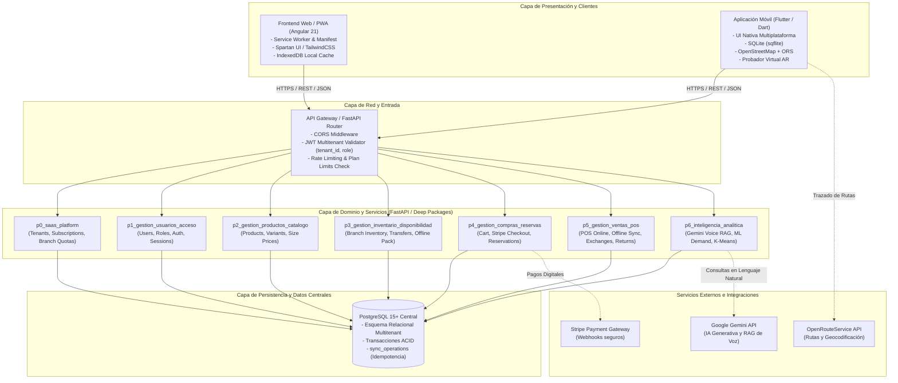
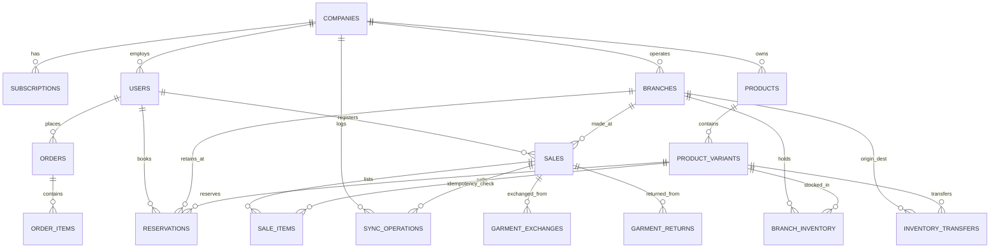

# ARQUITECTURA TÉCNICA DEL SISTEMA (2DO PARCIAL)
### FashionStore — Plataforma SaaS Multitenant E-Commerce
**Metodología:** ICONIX Process & Módulos Profundos (*Codebase Design*)  
**Patrón Arquitectónico:** Arquitectura Hexagonal / Limpia con Separación en 7 Paquetes de Dominio

---

## 1. Visión y Principios Arquitectónicos

La arquitectura de **FashionStore** está diseñada bajo tres directrices no negociables:
1. **Módulos Profundos (*Deep Modules*):** Interfaces públicas delgadas y estables (`router.py`) que ocultan implementaciones internas complejas y ricas (`service.py`, `repository.py`, `models.py`), eliminando dependencias circulares y facilitando la navegación del código.
2. **Aislamiento Multitenant Estricto (SaaS B2B2C):** Cada empresa cliente (*tenant*) opera en un espacio de datos estrictamente aislado mediante claves foráneas `tenant_id` y validación criptográfica en cada petición basada en tokens JWT.
3. **Resiliencia Desconectada (*Offline-First* con Idempotencia):** La operación comercial de las sucursales físicas (facturación en efectivo, inventario local y catálogo) no depende de la disponibilidad de Internet. La sincronización posterior garantiza cero transacciones duplicadas mediante UUIDs y tablas de auditoría.

---

## 2. Diagrama de Arquitectura Global del Ecosistema



---

## 3. Arquitectura del Backend (FastAPI + SQLAlchemy)

### 3.1. Estructura de Paquetes Profundos (`backend/app/packages/`)

El backend se organiza en 7 paquetes de dominio desacoplados. Cada paquete implementa el patrón **Repository-Service-Controller**:

```
backend/app/packages/
├── p0_saas_platform/                  # Gestión SaaS, Planes y Tenancy
│   ├── __init__.py                    # Limpio (sin re-exportes pesados)
│   ├── router.py                      # Endpoints: /api/companies, /api/subscriptions
│   ├── service.py                     # Reglas de negocio de límites de sucursales
│   ├── repository.py                  # Consultas SQLAlchemy a tablas SaaS
│   ├── models.py                      # Company, Subscription, Plan
│   └── schemas.py                     # Pydantic v2 schemas
├── p1_gestion_usuarios_acceso/        # Autenticación y Control de Acceso
│   ├── router.py                      # Endpoints: /api/auth, /api/users, /api/branches
│   ├── service.py                     # Lógica de login JWT con claim tenant_id
│   ├── repository.py                  # User, Role, Branch queries
│   ├── models.py                      # User, Role, Branch
│   └── schemas.py
├── p2_gestion_productos_catalogo/     # Catálogo de Prendas y Variantes
│   ├── router.py                      # Endpoints: /api/products, /api/categories
│   ├── service.py                     # Gestión de variantes con precio por talla
│   ├── repository.py                  # Product, Category, ProductVariant
│   ├── models.py
│   └── schemas.py
├── p3_gestion_inventario_disponibilidad/ # Stock Multisede y Modo Desconectado
│   ├── router.py                      # Endpoints: /api/inventory, /api/transfers, /api/catalog/offline-pack
│   ├── service.py                     # Empaquetado de catálogo para descarga offline
│   ├── repository.py                  # BranchInventory, InventoryTransfer
│   ├── models.py
│   └── schemas.py
├── p4_gestion_compras_reservas/       # Ventas Online y Reservas de Stock
│   ├── router.py                      # Endpoints: /api/orders, /api/reservations, /api/stripe
│   ├── service.py                     # Despacho contra pago Stripe y expiración de reservas
│   ├── repository.py                  # Order, OrderItem, Reservation
│   ├── models.py
│   └── schemas.py
├── p5_gestion_ventas_pos/             # Punto de Venta, Sincronización y Políticas
│   ├── router.py                      # Endpoints: /api/sales, /api/sales/offline/batch-sync, /api/exchanges, /api/returns
│   ├── service.py                     # Diferencia de precio en cambios, retenciones (20-50%) e idempotencia
│   ├── repository.py                  # Sale, SaleItem, SyncOperation, GarmentExchange, GarmentReturn
│   ├── models.py
│   └── schemas.py
└── p6_inteligencia_analitica/         # IA Generativa y Machine Learning
    ├── router.py                      # Endpoints: /api/analytics, /api/ai/voice-report, /api/ml/demand
    ├── service.py                     # Orquestación Gemini RAG, inferencia Scikit-Learn
    ├── repository.py                  # Agregaciones analíticas SQL
    ├── models.py                      # ModelCheckpoint, SyntheticConfig
    └── schemas.py
```

### 3.2. Regla de Oro de los Archivos `__init__.py`
Para erradicar fallos de importación circular durante el arranque de FastAPI:
- Los archivos `__init__.py` de los paquetes de dominio se mantienen **vacíos o con metadatos mínimos**.
- `backend/main.py` registra los routers importando explícitamente desde `.router` de cada paquete:
  ```python
  from app.packages.p0_saas_platform.router import router as p0_router
  from app.packages.p1_gestion_usuarios_acceso.router import router as p1_router
  from app.packages.p2_gestion_productos_catalogo.router import router as p2_router
  from app.packages.p3_gestion_inventario_disponibilidad.router import router as p3_router
  from app.packages.p4_gestion_compras_reservas.router import router as p4_router
  from app.packages.p5_gestion_ventas_pos.router import router as p5_router
  from app.packages.p6_inteligencia_analitica.router import router as p6_router
  ```

### 3.3. Capa de Shims de Compatibilidad (*Zero Breakage*)
Para asegurar que los tests existentes y módulos de soporte continúen funcionando sin fricción:
- `backend/app/models/__init__.py` re-exporta todas las clases de entidades SQLAlchemy desde sus respectivos paquetes.
- `backend/app/schemas/__init__.py` re-exporta los esquemas Pydantic.
- `backend/app/services/__init__.py` actúa como fachada delegadora hacia los servicios de cada paquete.

---

## 4. Esquema Relacional de Base de Datos (PostgreSQL)

El modelo de datos unifica el aislamiento multitenant y las operaciones del 2do parcial:



### Tablas Clave del 2do Parcial:
1. `companies` (`id UUID PK`, `name`, `subdomain`, `nit`, `status`, `created_at`).
2. `subscriptions` (`id UUID PK`, `company_id FK`, `plan_type` ['BASICO', 'PROFESIONAL'], `max_branches` [2 ó 10], `ai_enabled` [bool], `expires_at`).
3. `branches` (`id UUID PK`, `company_id FK`, `name`, `address`, `latitude`, `longitude`, `is_active`).
4. `product_variants` (`id UUID PK`, `product_id FK`, `sku`, `color`, `size` ['XS','S','M','L','XL','XXL'], `price` [Numeric(10,2) con variación por talla]).
5. `branch_inventory` (`id UUID PK`, `branch_id FK`, `variant_id FK`, `stock_available`, `stock_reserved`, `min_threshold`).
6. `sync_operations` (`id UUID PK`, `company_id FK`, `branch_id FK`, `operation_uuid UUID UNIQUE`, `operation_type`, `received_at`, `status` ['APLICADO', 'DUPLICADO_IGNORADO']).
7. `garment_exchanges` (`id UUID PK`, `original_sale_id FK`, `original_variant_id FK`, `new_variant_id FK`, `price_difference Numeric(10,2)`, `paid_difference bool`, `processed_at`).
8. `garment_returns` (`id UUID PK`, `sale_id FK`, `variant_id FK`, `original_price Numeric(10,2)`, `retention_percentage Numeric(5,2)` [20.00 a 50.00], `retention_amount Numeric(10,2)`, `refund_amount Numeric(10,2)`, `refund_method`).

---

## 5. Arquitectura del Frontend Web / PWA (Angular 21)

El frontend está construido sobre **Angular 21** configurado con capacidades completas de **Progressive Web App (PWA)**:

### 5.1. Componentes PWA y Modo Desconectado
- **Service Worker (`ngsw-worker.js`):** Intercepta las solicitudes HTTP. Los recursos estáticos (HTML, JS, CSS, imágenes e iconos) se almacenan en el Cache Storage del navegador.
- **Web App Manifest (`manifest.webmanifest`):** Permite la instalación nativa de la aplicación en el escritorio o pantalla de inicio del dispositivo móvil del cajero/cliente con modo `display: standalone`.
- **Capa de Persistencia Local con IndexedDB:**
  - Al iniciar sesión con red, el servicio `OfflineCatalogService` descarga el catálogo comprimido y lo guarda en el almacén de objetos `catalog_store`.
  - Cuando el navegador emite el evento `navigator.onLine === false`, el servicio de ventas conmute automáticamente a `OfflinePosService`.
  - Las ventas se guardan en el almacén `pending_sales` con UUIDv4 local y estado `PENDIENTE_SYNC`.
  - Un listener del evento `window.addEventListener('online', ...)` activa automáticamente la sincronización por lotes contra el endpoint de batch sync.

### 5.2. Capa Visual y Diseño
- **TailwindCSS 3.4+:** Clases utilitarias de alto rendimiento.
- **Spartan UI / Lucide Icons:** Componentes accesibles, minimalistas y responsivos con feedback visual para el modo offline (insignia de estado de red en barra superior).

---

## 6. Arquitectura de la Aplicación Móvil (Flutter)

La aplicación móvil está estructurada en **Flutter** bajo un enfoque de **Clean Architecture**:

```
mobile/lib/
├── core/
│   ├── network/                       # Interceptor Dio con JWT y manejo offline
│   ├── database/                      # SQLite OpenHelper (sqflite)
│   └── theme/                         # Paleta y tipografías consistentes
├── features/
│   ├── auth/                          # Login multitenant y almacenamiento seguro
│   ├── catalog/                       # Grilla facetada y visor offline
│   ├── geolocation/                   # OpenStreetMap (flutter_map) + OpenRouteService
│   ├── ar_fitting/                    # Probador virtual con Realidad Aumentada
│   └── pos_offline/                   # Venta en efectivo offline y sincronización
```

### 6.1. Persistencia Local con SQLite (`sqflite`)
- El dispositivo almacena dos tablas locales primarias:
  - `local_catalog`: Cache de productos y variantes con precios por talla.
  - `local_offline_sales`: Cola transaccional de ventas realizadas en efectivo sin conexión con campo `uuid TEXT PRIMARY KEY`.

### 6.2. Geolocalización Libre (OpenStreetMap + OpenRouteService)
- Se sustituye Google Maps por **OpenStreetMap** mediante la librería `flutter_map` (libre de cuotas y API keys de pago restrictivas).
- El cálculo de rutas óptimas hacia las sucursales del tenant se realiza invocando los endpoints REST de **OpenRouteService (ORS)**, renderizando polilíneas de navegación sobre el mapa en tiempo real.

### 6.3. Probador Virtual (AR)
- Módulo móvil que accede a la cámara del dispositivo y posiciona prendas 2D/3D escaladas sobre la silueta del cliente para evaluar combinación de color y proporciones.

---

## 7. Módulo de Inteligencia Artificial y Machine Learning (`p6`)

### 7.1. IA Generativa Asistida por Voz (Google Gemini API)
- **Entrada:** La aplicación captura audio mediante Web Audio API / Flutter Sound y lo transcribe a texto o lo envía como stream de audio.
- **Técnica RAG (Retrieval-Augmented Generation):** El backend ejecuta consultas agregadas SQL a PostgreSQL (ej. ventas por sucursal, productos con menor rotación, balances de retenciones) y ensambla un contexto seguro inyectado en el prompt de Gemini.
- **Salida Dual:** Gemini devuelve una respuesta estructurada en JSON conteniendo:
  1. Texto natural explicativo (reproducido por el navegador mediante *SpeechSynthesis*).
  2. Datos numéricos que el frontend utiliza para renderizar gráficos instantáneos.

### 7.2. Machine Learning Supervisado: Predicción de Demanda
- **Objetivo:** Predecir las unidades de venta requeridas por categoría y talla para las próximas 4 semanas.
- **Algoritmo:** Regresión Lineal / Random Forest Regressor implementado en **Scikit-Learn**.
- **Entrenamiento:** Entrenado con un dataset sintético (`synthetic_fashion_sales.csv`) con más de 10,000 registros que reflejan estacionalidad, clima y días pico de ventas en tiendas de moda.

### 7.3. Machine Learning No Supervisado: Segmentación de Clientes
- **Objetivo:** Agrupar la base de clientes en segmentos accionables para marketing y mitigación de devoluciones.
- **Algoritmo:** **K-Means Clustering** con 4 centroides óptimos (determinados mediante el método del codo sobre variables de Recencia, Frecuencia, Valor Monetario e Índice de Devoluciones).
