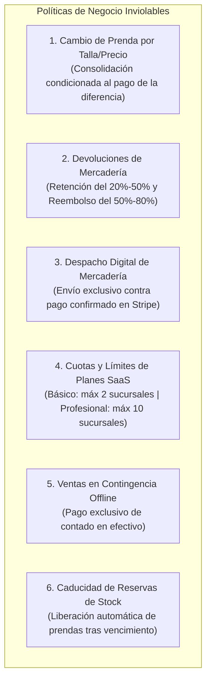

# POLÍTICAS DE NEGOCIO Y REGLAS DE DOMINIO INVIOLABLES
### FashionStore — Plataforma SaaS Multitenant E-Commerce
**Materia:** Sistemas de Información 2 (2do Parcial)  
**Normativa:** Pliego Oficial de Requisitos y Directrices de Cátedra

---

## 1. Justificación y Propósito

En la comercialización de moda, calzado y confección textil, la rentabilidad y la integridad de inventario dependen del cumplimiento estricto de las reglas comerciales. Este documento codifica las políticas de negocio del sistema que **ningún componente de software puede omitir, puentear o relajar**.

---

## 2. Catálogo Oficial de Políticas de Negocio



---

### POLÍTICA 1: Cambio de Prenda con Diferencia de Precio (CU19)

#### Declaración de la Regla:
> *Al cambiar una prenda por otra talla o modelo de confección distinta, el precio de la prenda puede variar. El cambio de prenda se consolida **ÚNICAMENTE Y EXCLUSIVAMENTE CUANDO EL CLIENTE PAGA LA DIFERENCIA DE PRECIO**. Si el cliente no abona dicha diferencia, la operación queda cancelada y se restituye la prenda original o el pago.*

#### Lógica y Casos de Prueba:
- **Ejemplo Típico de la Cátedra:**
  - Prenda Original: Vestido Modelo *Aurora*, Talla **M** — Precio abonado originalmente: **Bs 50**.
  - Prenda Nueva Solicitada: Vestido Modelo *Aurora*, Talla **L** (o tela reforzada) — Precio de lista: **Bs 70**.
  - **Cálculo de la Diferencia ($\Delta$):**
    $$\Delta = \text{Precio Prenda Nueva} - \text{Precio Prenda Original} = 70.00 - 50.00 = +\text{Bs } 20.00$$
- **Condición de Consolidación:**
  1. Si el cliente abona los **Bs 20.00** en caja $\rightarrow$ Se asienta el cambio, se ingresa la talla M al inventario, se descuenta la talla L y se emite el comprobante de cambio consolidado.
  2. Si el cliente **NO** abona los **Bs 20.00** $\rightarrow$ El sistema cancela la transacción de inmediato; no se mueve inventario y el cliente conserva su prenda talla M.
- **Caso de Prenda Nueva de Menor Precio ($\Delta < 0$):**
  - Si el cliente cambia una prenda de Bs 70 por una de Bs 50 ($\Delta = -20.00$), la tienda emite una **Nota de Crédito** o vale de compra a favor del cliente por Bs 20.00 para futuras compras.

---

### POLÍTICA 2: Devolución de Prendas con Retención Operativa (CU20)

#### Declaración de la Regla:
> *La tienda aplica una política de retención porcentual parametrizable entre el **20% y el 50%** del valor abonado por concepto de costos logísticos, desinfección textil e inspección de calidad, reembolsando al cliente entre el **50% y el 80%** del importe pagado.*

#### Parámetros del Tenant:
Cada empresa tenant configura en su panel el porcentaje exacto de retención según su política comercial:
- **Porcentaje de Retención ($R$):** Configurable en el rango $[20.00\%, 50.00\%]$.
- **Porcentaje de Reembolso:** $100\% - R$ (resultando en el rango $[50.00\%, 80.00\%]$).

#### Lógica y Fórmulas:
Sea $P_{\text{abonado}}$ el importe pagado por la prenda:
$$\text{Monto Retención} = P_{\text{abonado}} \times \left(\frac{R}{100}\right)$$
$$\text{Monto Reembolso} = P_{\text{abonado}} - \text{Monto Retención}$$

- **Ejemplo con Retención del 30% ($R = 30\%$):**
  - Precio abonado: $P_{\text{abonado}} = \text{Bs } 100.00$.
  - Retención operativa (30%): $\text{Bs } 30.00$ (queda a favor de la empresa).
  - Reembolso entregado al cliente (70%): $\text{Bs } 70.00$ (en efectivo o nota de crédito).
- **Validación Física:** El cajero debe constatar que la prenda no presente signos de uso, conserve las etiquetas originales y se encuentre dentro de los días hábiles estipulados (ej. 7 días tras la compra).

---

### POLÍTICA 3: Despacho Digital Condicionado a Pago Confirmado (CU12)

#### Declaración de la Regla:
> *El empaque, despacho o entrega de prendas adquiridas digitalmente se realiza **ÚNICA Y EXCLUSIVAMENTE CUANDO EL PAGO ESTÁ CONFIRMADO EN LA PASARELA STRIPE** (`status = 'paid'`). Ninguna orden en estado 'pendiente' o 'fallida' puede generar guía de despacho.*

#### Protocolo de Validación:
1. El cliente completa el formulario de pago en Stripe Elements.
2. La orden de compra se crea provisionalmente con estado `PENDIENTE_PAGO`.
3. El almacén logístico **NO** visualiza la orden en su cola de preparación de envíos.
4. El webhook seguro de Stripe notifica al backend el evento `payment_intent.succeeded` con validación criptográfica de firma `stripe-signature`.
5. El backend actualiza la orden a `PAGADA` y genera automáticamente la orden de despacho en estado `LISTA_PARA_ENVIO`.

---

### POLÍTICA 4: Cuotas y Límites de Planes de Suscripción SaaS (CU02/CU04)

#### Declaración de la Regla:
> *El sistema SaaS impone cuotas operativas forzadas por el backend de acuerdo al plan contratado por la empresa:*
> - **Plan Básico:** Permite un máximo de **2 sucursales físicas activas**. No tiene acceso a módulos de IA Generativa ni analítica avanzada.
> - **Plan Profesional:** Permite hasta **10 sucursales físicas activas**, acceso ilimitado a consultas con IA Generativa (Gemini con voz), predicción de demanda supervisada y segmentación K-Means.

#### Forzado a Nivel de API:
- Endpoint `POST /api/branches`:
  ```python
  active_branches = repo.count_active_branches(tenant_id)
  plan_limit = subscription.max_branches # 2 ó 10
  if active_branches >= plan_limit:
      raise HTTPException(
          status_code=403, 
          detail=f"Límite alcanzado ({active_branches}/{plan_limit} sucursales). Actualice su plan a Profesional."
      )
  ```

---

### POLÍTICA 5: Venta en Contingencia Offline en Efectivo (CU16)

#### Declaración de la Regla:
> *Durante el modo desconectado (caída de Internet en la sucursal), la única forma de pago permitida es **EFECTIVO (Contado)**. La venta con tarjeta y crédito digital queda inhabilitada para prevenir fraudes financieros sin validación de fondos en línea.*

#### Reglas de Operación:
- Generación obligatoria de `operation_uuid` (UUIDv4) antes de asentar en la base local (IndexedDB / SQLite).
- Estado transaccional inicial: `PENDIENTE_SYNC`.
- Emisión de ticket impreso de contingencia con leyenda visible: *“Venta Offline - Sujeta a sincronización central”*.

---

### POLÍTICA 6: Caducidad y Liberación de Reservas de Prendas (CU13/CU14)

#### Declaración de la Regla:
> *Toda reserva física de prenda cuenta con un tiempo límite de vigencia (ej. 24 horas). Si el cliente no acude a la sucursal a consolidar la compra dentro del plazo, el sistema **LIBERA EL STOCK AUTOMÁTICAMENTE**, devolviendo las unidades al inventario público.*

#### Lógica de Liberación:
- Se ejecuta un proceso en segundo plano en el backend que evalúa:
  $$\text{Condición de Caducidad: } \text{status} = \text{'RESERVADA'} \quad \land \quad \text{fecha\_actual} \ge \text{fecha\_expiracion}$$
- Acción automática:
  - Cambiar estado a `EXPIRADA_CANCELADA`.
  - Decrementar `stock_reserved` en `branch_inventory`.
  - Incrementar `stock_available` en `branch_inventory`.
