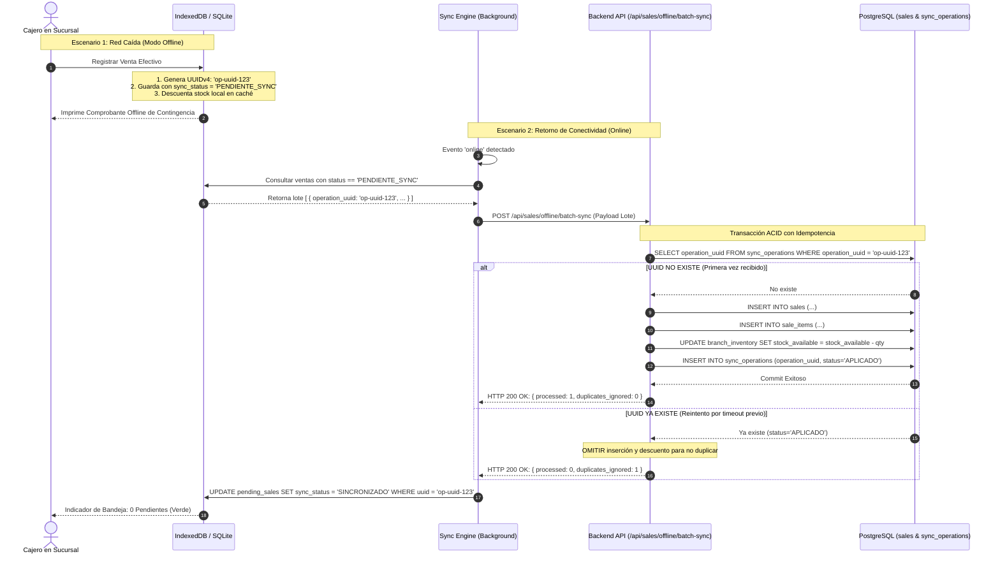

# PROTOCOLO DE MODO DESCONECTADO (OFFLINE-FIRST) Y SINCRONIZACIÓN IDEMPOTENTE
### FashionStore — Plataforma SaaS Multitenant E-Commerce
**Subsistemas:** Frontend Web PWA (Angular 21 + IndexedDB), Mobile (Flutter + SQLite), Backend (FastAPI + PostgreSQL)

---

## 1. Filosofía Offline-First del Negocio

En el entorno comercial físico (centros comerciales, ferias y galerías de ropa), los cortes de energía o caídas del proveedor de Internet no pueden interrumpir las ventas en el mostrador.

El sistema implementa una arquitectura **Offline-First** que asegura que:
1. Las prendas y variantes de precio por talla estén disponibles para lectura inmediata sin conexión.
2. Los cajeros puedan registrar ventas en contingencia sin Internet.
3. Se garantice la **idempotencia absoluta**: un ticket offline jamás se duplicará ni cobrará dos veces en el servidor central, sin importar cuántas veces se reintente el envío por inestabilidad de red.

---

## 2. Reglas Comerciales Inviolables del Modo Desconectado

1. **Modalidad de Pago Exclusiva en Efectivo (Contado):**
   - Durante el modo offline, los pagos con tarjeta de crédito/débito y pasarelas digitales (Stripe) quedan **estrictamente deshabilitados**.
   - Solo se permite la venta de contado en efectivo contra entrega inmediata de la prenda física.
2. **Generación Local de Identificadores (UUIDv4):**
   - Toda transacción offline se bautiza en el cliente con un `operation_uuid` generado mediante el estándar UUIDv4 antes de guardarse en el almacenamiento local.
3. **Caché Reactivo de Catálogo e Inventario Local:**
   - La terminal descuenta inmediatamente las unidades vendidas en su base de datos local para que el cajero no vuelva a vender por error una prenda física ya entregada.

---

## 3. Esquemas de Persistencia Local

### 3.1. Frontend Web / PWA: IndexedDB (`idb`)

En el navegador web, el almacenamiento se gestiona a través de una base de datos local **IndexedDB** denominada `fashionstore_local_db` (Versión 1):

```
Base de Datos: fashionstore_local_db
├── Almacén: catalog_products
│   ├── KeyPath: id (UUID)
│   ├── Índices: by_category, by_name
│   └── Estructura: { id, name, category, image_url, description, updated_at }
│
├── Almacén: catalog_variants
│   ├── KeyPath: id (UUID)
│   ├── Índices: by_product_id, by_sku
│   └── Estructura: { id, product_id, sku, size, color, price, local_stock }
│
└── Almacén: pending_sales (Bandeja de Salida)
    ├── KeyPath: operation_uuid (UUID)
    ├── Índices: by_status, by_created_at
    └── Estructura: {
          operation_uuid: "9b1deb4d-3b7d-4bad-9bdd-2b0d7b3dcb6d",
          branch_id: "...",
          cashier_id: "...",
          items: [
            { variant_id: "...", quantity: 1, unit_price: 70.00, subtotal: 70.00 }
          ],
          total_amount: 70.00,
          payment_method: "EFECTIVO",
          created_at: "2026-10-24T10:15:30Z",
          sync_status: "PENDIENTE_SYNC"
        }
```

### 3.2. Aplicación Móvil Flutter: SQLite (`sqflite`)

En el dispositivo móvil, el esquema se crea mediante SQLite embebido:

```sql
-- Tabla de catálogo local en SQLite móvil
CREATE TABLE local_variants (
    id TEXT PRIMARY KEY,
    product_id TEXT NOT NULL,
    product_name TEXT NOT NULL,
    sku TEXT NOT NULL,
    size TEXT NOT NULL,
    color TEXT NOT NULL,
    price REAL NOT NULL,
    local_stock INTEGER NOT NULL
);

-- Tabla de ventas pendientes de sincronización
CREATE TABLE local_offline_sales (
    operation_uuid TEXT PRIMARY KEY,
    branch_id TEXT NOT NULL,
    cashier_id TEXT NOT NULL,
    total_amount REAL NOT NULL,
    payment_method TEXT DEFAULT 'EFECTIVO',
    items_json TEXT NOT NULL,
    created_at TEXT NOT NULL,
    sync_status TEXT DEFAULT 'PENDIENTE_SYNC'
);
```

---

## 4. Ciclo de Vida y Flujo de Sincronización Idempotente

El siguiente diagrama detalla la interacción entre el Cliente (PWA/Mobile), el Sync Engine y el Backend Central:



---

## 5. Especificación del Endpoint de Sincronización en Lote

### Ruta: `POST /api/sales/offline/batch-sync`
- **Cabeceras:** `Authorization: Bearer <jwt_token>` (Validación estricta de `tenant_id`).
- **Cuerpo de la Petición (`BatchSyncRequestSchema`):**
```json
{
  "branch_id": "8a3e7b21-654a-4e2b-9c88-7e3f2d1a0b9c",
  "operations": [
    {
      "operation_uuid": "550e8400-e29b-41d4-a716-446655440000",
      "cashier_id": "110e8400-e29b-41d4-a716-446655440001",
      "total_amount": 140.00,
      "payment_method": "EFECTIVO",
      "created_at": "2026-10-24T10:15:30Z",
      "items": [
        {
          "variant_id": "220e8400-e29b-41d4-a716-446655440002",
          "quantity": 2,
          "unit_price": 70.00,
          "subtotal": 140.00
        }
      ]
    }
  ]
}
```

- **Respuesta Exitosa (`BatchSyncResponseSchema`):**
```json
{
  "status": "success",
  "summary": {
    "total_received": 1,
    "applied": 1,
    "duplicates_ignored": 0,
    "conflicts": 0
  },
  "processed_uuids": [
    "550e8400-e29b-41d4-a716-446655440000"
  ]
}
```

---

## 6. Tratamiento de Conflictos de Inventario

En escenarios infrecuentes donde se realizó una reserva online simultáneamente mientras la tienda operaba offline:
- **Principio de Venta Consolidada:** Dado que la prenda física fue entregada físicamente al cliente que pagó en efectivo, la venta offline **siempre se asienta**.
- **Ajuste de Stock:** Si el stock central llega a quedar en negativo por solapamiento con una reserva no asistida, el sistema:
  1. Asienta la venta y la auditoría.
  2. Ajusta el stock a cero.
  3. Emite una alerta de discrepancia en el dashboard del encargado de sucursal (`StockDiscrepancyLog`).
