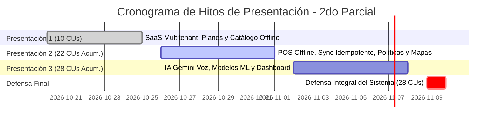

# CRONOGRAMA DE ENTREGAS Y HOJA DE RUTA DE PRESENTACIONES
### FashionStore — Plataforma SaaS Multitenant E-Commerce
**Materia:** Sistemas de Información 2 (2do Parcial)  
**Modalidad de Presentación:** Entregas Incrementales Acumulativas (Sin Ciclos RUP)  
**Total de Casos de Uso:** 28 Casos de Uso Oficiales

---

## 1. Directriz Metodológica de Cátedra

Por disposición de la docente de la asignatura:
> *“El informe final y las defensas se estructuran **sin iteraciones ni ciclos RUP**. El equipo presenta los Casos de Uso trabajados y los incrementa acumulativamente en cada hito de revisión, demostrando el software funcionando de extremo a extremo.”*

Cada presentación suma nuevas funcionalidades sobre la base anterior, garantizando que el sistema crezca de forma estable y verificable.

---

## 2. Cronograma Oficial de Hitos y Casos de Uso

---

### HITO 1: Presentación 1 (25 de Octubre de 2026)
**Meta:** Establecer la infraestructura SaaS multitienda, control de cuotas por plan y catálogo de prendas con variantes de talla/precio y almacenamiento desconectado inicial.  
**Alcance Acumulado:** 10 Casos de Uso (CU01 al CU10).

| Código | Caso de Uso | Paquete | Plataforma | Criterio de Aceptación / Verificación |
| :---: | :--- | :---: | :---: | :--- |
| **CU01** | Registrar y Gestionar Empresas (Tenants) | `p0` / `p1` | Web | Creación de tenant con `subdomain` único y aislamiento a nivel de base de datos. |
| **CU02** | Gestionar Planes de Suscripción y Límites | `p0` | Web | Asignación de Plan Básico (máx. 2 sucursales) y Profesional (máx. 10 sucursales). |
| **CU03** | Iniciar Sesión Multitenant con JWT | `p1` | Web / Móvil | Autenticación con claims de `tenant_id` y `role` en token criptográfico. |
| **CU04** | Gestionar Sucursales Bajo Límites del Plan | `p1` | Web | Bloqueo estricto del backend si se intenta registrar una 3ra sucursal en Plan Básico. |
| **CU05** | Gestionar Perfil y Preferencias de Usuario | `p1` | Web / Móvil | Edición de credenciales y datos de cuenta de usuario. |
| **CU06** | Gestionar Prendas y Variantes de Precio/Talla | `p2` | Web | Registro de prendas con precios diferenciados por talla (ej. Talla M a Bs 50 vs Talla L a Bs 70). |
| **CU07** | Consultar Catálogo Online con Búsqueda Facetada | `p2` | Web / Móvil | Filtros en vivo por categoría, rango de precios y tallas. |
| **CU08** | Descargar Catálogo a Base Local (IndexedDB/SQLite)| `p3` | PWA / Móvil | Descarga y persistencia local del catálogo para consulta sin conexión. |
| **CU09** | Consultar Catálogo Offline en Modo Desconectado | `p3` | PWA / Móvil | Navegación íntegra por prendas y tallas en modo avión o sin red. |
| **CU10** | Consultar Disponibilidad de Stock por Sucursal | `p3` | Web / Móvil | Visualización del inventario desglosado por tienda física. |

---

### HITO 2: Presentación 2 (01 de Noviembre de 2026)
**Meta:** Implementar el motor comercial completo: ventas online con Stripe y despacho condicionado, reservas físicas con caducidad, traslados entre tiendas, terminal POS offline con sincronización idempotente (`sync_operations`), políticas inviolables de cambio/devolución y navegación geográfica con OpenStreetMap en Flutter.  
**Alcance Acumulado:** 22 Casos de Uso (10 anteriores + 12 nuevos = CU01 al CU22).

| Código | Caso de Uso | Paquete | Plataforma | Criterio de Aceptación / Verificación |
| :---: | :--- | :---: | :---: | :--- |
| **CU11** | Registrar y Autorizar Traslados de Mercadería | `p3` | Web | Movimiento de stock entre sucursales con control de origen y destino. |
| **CU12** | Comprar Prendas con Stripe y Despacho Condicionado | `p4` | Web / Móvil | Cobro exitoso vía webhook Stripe; el despacho se autoriza **únicamente** cuando `status = 'paid'`. |
| **CU13** | Crear Reserva de Prendas con Vencimiento | `p4` | Web / Móvil | Apartado de stock en sucursal con temporizador de caducidad (24h). |
| **CU14** | Atender y Resolver Conflictos de Reservas | `p4` | Web / Backend | Liberación automática de stock vencido y venta de reserva asistida. |
| **CU15** | Registrar Venta Directa en POS Online | `p5` | Web / Móvil POS | Venta presencial con descuento de inventario en tiempo real. |
| **CU16** | Registrar Venta Offline en Efectivo con UUID | `p5` | PWA / Móvil POS | Venta desconectada **exclusivamente en efectivo**, con UUIDv4 y guardado local. |
| **CU17** | Gestionar Bandeja Local de Operaciones Pendientes | `p5` | PWA / Móvil POS | Interfaz con contador numérico de ventas en estado `PENDIENTE_SYNC`. |
| **CU18** | Sincronizar Lotes de Ventas con Idempotencia | `p5` | Background / API | Endpoint `/api/sales/offline/batch-sync` con auditoría en `sync_operations` (cero duplicados). |
| **CU19** | Procesar Cambio de Prenda con Diferencia de Precio| `p5` | Web POS | Cambio de talla M a L: **se consolida solo si el cliente abona los Bs 20 de diferencia**. |
| **CU20** | Procesar Devolución con Retención del 20%-50% | `p5` | Web POS | Retención operativa del 30% sobre el valor abonado y reembolso neto del 70%. |
| **CU21** | Localizar Sucursales y Trazar Rutas (OpenStreetMap)| `p6` | Móvil Flutter | Mapa libre en Flutter con cálculo de rutas mediante OpenRouteService. |
| **CU22** | Probar Prendas en Realidad Aumentada (AR) | `p6` | Móvil Flutter | Superposición de prenda sobre la silueta del cliente mediante cámara móvil. |

---

### HITO 3: Presentación 3 (08 de Noviembre de 2026)
**Meta:** Incorporar la capa de Inteligencia Artificial y Analítica Predictiva: consultas ejecutivas por voz con Gemini API (RAG), exportación formal a PDF/Excel, dataset sintético de retail de moda, modelo supervisado de demanda, clustering no supervisado K-Means y dashboard ejecutivo con KPIs.  
**Alcance Acumulado:** 28 Casos de Uso Completos (22 anteriores + 6 nuevos = CU01 al CU28).

| Código | Caso de Uso | Paquete | Plataforma | Criterio de Aceptación / Verificación |
| :---: | :--- | :---: | :---: | :--- |
| **CU23** | Generar Reportes Ejecutivos por Voz y Lenguaje Natural| `p7` | Web / Móvil | Consulta RAG a Gemini con entrada de voz y respuesta hablada (TTS) con gráficos. |
| **CU24** | Exportar Balances Dinámicos a PDF y Excel | `p7` | Web | Generación de balances consolidados de ventas, retenciones y stock. |
| **CU25** | Generar Dataset Sintético de Ventas y Estacionalidad| `p7` | Backend Script | Generación estocástica de 10,000+ registros con estacionalidad de moda. |
| **CU26** | Predecir Demanda de Ropa (Supervisado) | `p7` | Web / Backend | Modelo Scikit-Learn de predicción de ventas por talla y categoría ($R^2 \ge 0.82$). |
| **CU27** | Segmentar Clientes con K-Means (No Supervisado) | `p7` | Web / Backend | Algoritmo K-Means con 4 clusters según Recencia, Frecuencia, Gasto y Devoluciones. |
| **CU28** | Visualizar Dashboard Ejecutivo con KPIs | `p7` | Web | Tablero de mando con métricas de ventas, stock crítico, retenciones y sincronización. |

---

### HITO 4: Defensa Final Oficial (10 de Noviembre de 2026)
**Meta:** Defensa integral y rigurosa ante el tribunal docente de la plataforma FashionStore.
- Demostración en vivo de los **28 Casos de Uso**.
- Presentación del informe formal bajo metodología **ICONIX** (Fichas de CU, Diagramas de Robustez con loops en Controlador, Diagramas de Secuencia y Clases).
- Anexos con modelos del 1er Parcial (Diseño conceptual, lógico, despliegue y clases).
- Verificación en vivo de resiliencia: corte de Internet en terminal POS, venta offline en efectivo, reconexión de red y sincronización idempotente sin transacciones duplicadas.
